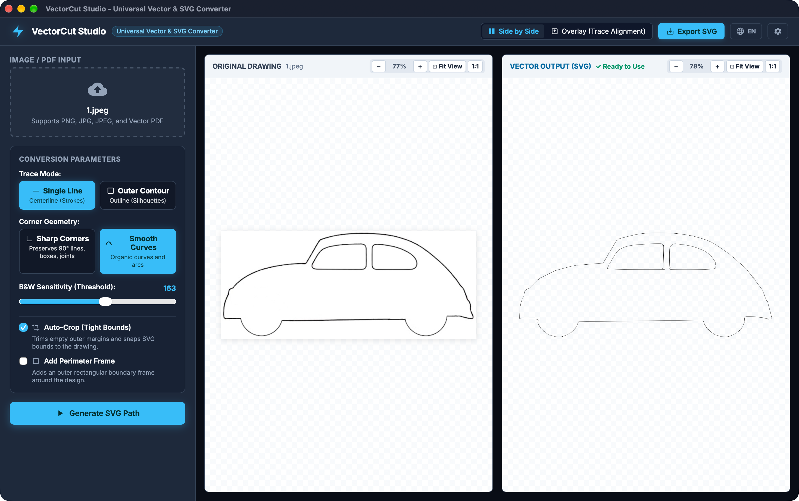
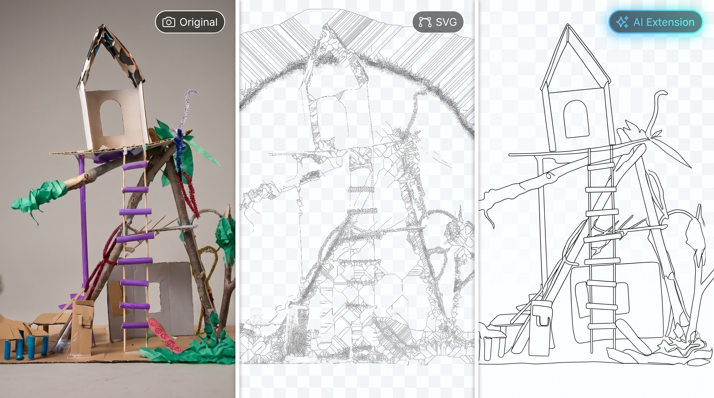
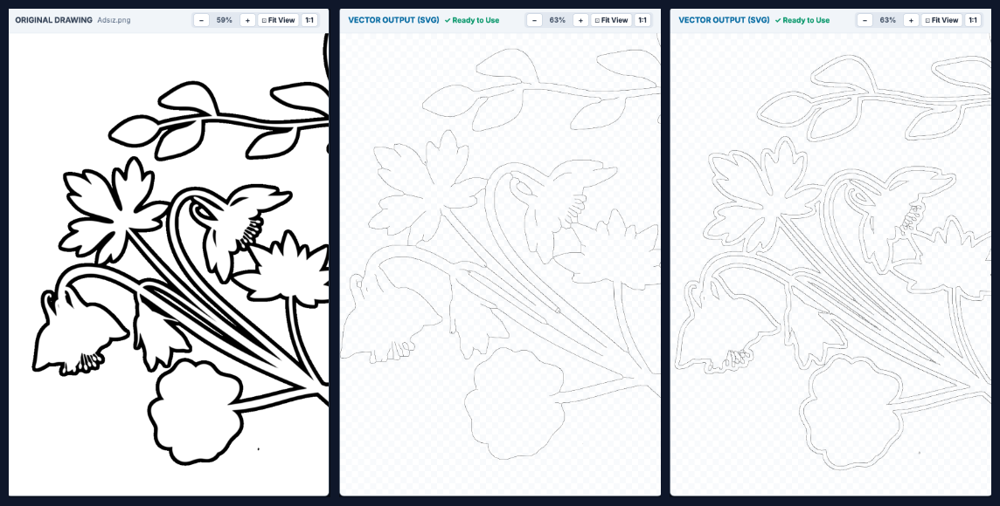

# ⚡️ VectorCut Studio

> **High-performance, zero-dependency desktop studio that transforms raster drawings (PNG, JPG, PDF) into clean, single-line (centerline) or outline vector paths (SVG).**

[](LICENSE)
[]()
[]()
[](.github/workflows/ci.yml)

<p align="center">
  
</p>

---

## 🎯 The Problem

Standard vectorizers (like Potrace or typical image-trace tools) wrap around the **outer perimeter of raster lines**, creating **double paths** for every stroke. When sent to CNC machines, pen plotters, laser cutters, or vinyl cutters:

* A single drawn line gets traced twice, causing **double passes** and burnt edges.
* 90° sharp corners get rounded, ruining mechanical joints and architectural blueprints.
* Empty margins waste workspace area and require manual canvas cropping.

**VectorCut Studio** solves this with a dedicated pure-Rust skeletonization and medial-axis tracing engine, producing **exact single-line centerlines** or crisp silhouette outlines in milliseconds with zero external CLI dependencies.

---

## ✨ Features

* **⚡️ Single-Line (Centerline) Extraction:** Converts thick raster strokes into genuine 1-pixel medial-axis single paths. No double cutting, no double plotting.
* **🧠 AI LineArt Extension (Multi-Color & Real-world Photos):**
  * Transforms full-color photos, illustrations, and 3D models into clean line art before tracing.
  * Powered by local pure-Rust ONNX inference (`tract-onnx`) with zero Python or C++ runtime overhead.
  * Preserves aspect ratio with letterboxing and applies contrast gamma enhancement.
  * On-demand 1-click model download keeps base installer ultra-lightweight (~1.7 MB).
* **📐 Geometry Preservation (Sharp vs. Smooth):**
  * **Sharp Corners:** Preserves crisp 90-degree lines, mortise & tenon joints, slots, and architectural windows.
  * **Smooth Curves:** Converts organic curves into fluid cubic Bezier paths.
* **🔍 Responsive Pan & Zoom Viewport:**
  * Freehand canvas panning and wheel/trackpad zoom up to 4000%.
  * **Coordinate Persistence:** Keeps your current zoom level and pan coordinates locked in place while tweaking thresholds or corner types.
  * Double-click or click **⊡ Fit** to snap to view.
* **🎯 Overlay Alignment View:** Superimposes the red vector trajectory over the semi-transparent original sketch to inspect vector accuracy down to the pixel.
* **✂️ Tight Auto-Crop:** Automatically detects the outer pixel bounding box and eliminates empty whitespace margins.
* **🔲 Perimeter Boundary Framing:** Optionally generates a clean rectangular cutting/mounting perimeter around freestanding drawings.
* **📄 Lossless Vector PDF Ingestion:** Directly parses vector blueprint operators (`m`, `l`, `c`, `re`, `S`) without rasterization distortion.
* **⚙️ Preferences & Configurable Suffixes:**
  * Custom export suffixes (e.g. `_centerline`, `_outline`).
  * Instant interface language toggle (English default & Turkish).
* **🪶 Ultra Lightweight:** Built with Tauri v2 and native OS WebKit/WebView2 (~1.7 MB installer, minimal RAM footprint).

---

## 🔬 Visual Comparisons & Showcases

### 1. 🧠 AI LineArt Extension (Real-World Photo to Clean Vector)
Standard thresholding fails on real-world photographs because surface textures, lighting gradients, and shadows become dense, unusable noise. VectorCut's pure-Rust AI LineArt extension isolates clean, machine-ready geometric contours:

<p align="center">
  
</p>

> **📷 Original Photo** *(Left)* &nbsp;→&nbsp; **Standard Tracing Without AI** *(Middle: blocked shadows & dense artifact noise)* &nbsp;→&nbsp; **✨ VectorCut AI Extension** *(Right: clean, crisp structural vector paths)*

---

### 2. 📐 Trace Modes: Single Line (Centerline) vs. Outer Contour (Outline)
Choose between single medial-axis strokes for CNC routing/pen plotting or closed silhouette perimeters for laser/vinyl cutting:

<p align="center">
  
</p>

> **Original Drawing** *(Left)* &nbsp;|&nbsp; **Single-Line Centerline** *(Middle: 1 stroke per stem, zero double-burns)* &nbsp;|&nbsp; **Outer Contour** *(Right: boundary silhouettes for cutting)*

---

## 🔌 Universal Compatibility

VectorCut produces standard, unstyled, clean SVG paths (`fill="none" stroke="#000000" stroke-width="0.5"`) directly compatible with:

* **Pen Plotters & Drawbots:** AxiDraw, HPGL plotters, custom CNC pens
* **Laser Cutters:** LightBurn, Snapmaker Luban, LaserGRBL, xTool Creative Space, Glowforge
* **Vinyl & Craft Cutters:** Cricut Design Space, Silhouette Studio
* **Vector Design Software:** Adobe Illustrator, Inkscape, Affinity Designer, CorelDRAW

---

## 🚀 Installation & Downloads

Pre-built binaries are available for every major desktop operating system on the [Releases](https://github.com/tayyarufkun/vectorcut/releases) page:

| Platform | Download Format | Notes |
| :--- | :--- | :--- |
| **macOS** | `.dmg` | Universal (Apple Silicon M1/M2/M3/M4 & Intel x86_64) |
| **Windows** | `.exe` / `.msi` | 64-bit installer with native WebView2 |
| **Linux** | `.AppImage` / `.deb` | Standalone portable executable |

---

## 🛠️ Build from Source

### Prerequisites

* [Node.js](https://nodejs.org/) (v18 or higher) & `npm`
* [Rust](https://www.rust-lang.org/) (stable toolchain)
* Platform-specific Tauri prerequisites (see [Tauri Prerequisites](https://v2.tauri.app/start/prerequisites/))

### Steps

1. Clone the repository:
   ```bash
   git clone https://github.com/tayyarufkun/vectorcut.git
   cd vectorcut
   ```

2. Install frontend dependencies:
   ```bash
   npm install
   ```

3. Run in development mode:
   ```bash
   npm run tauri dev
   ```

4. Run test suites:
   ```bash
   cd src-tauri && cargo test
   ```

5. Build production bundle (.dmg / .exe / .AppImage):
   ```bash
   npm run tauri build
   ```

---

## 🏛️ Architecture

```text
vectorcut/
├── src/                          # Svelte 5 + Vite Frontend
│   ├── components/
│   │   ├── Canvas.svelte         # Dual-viewport Pan & Zoom & Overlay rendering
│   │   ├── Dropzone.svelte       # Native file picker and drag-and-drop
│   │   ├── Sidebar.svelte        # Threshold, corner mode, crop parameters
│   │   ├── Toolbar.svelte        # Export actions, view toggles, status
│   │   ├── PreferencesModal.svelte # Persistent language and suffix configuration
│   │   └── LanguageModal.svelte  # Instant language selector dialog
│   ├── lib/
│   │   ├── api.ts                # Type-safe Tauri IPC bridge
│   │   ├── i18n.ts               # Multi-language dictionary (EN / TR)
│   │   ├── panzoom.ts            # Hardware-accelerated viewport manipulation
│   │   └── preferences.ts        # LocalStorage settings persistence
│   └── App.svelte
├── src-tauri/                    # Pure Rust Core (Zero external binaries)
│   ├── src/
│   │   ├── main.rs               # Tauri IPC handlers & native OS dialogs (rfd)
│   │   ├── image_proc.rs         # Alpha-blending, luminance & binarization
│   │   ├── autocrop.rs           # Pixel bounding box boundary extraction
│   │   ├── tracer.rs             # Zhang-Suen thinning, graph traversal, RDP simplification
│   │   └── pdf.rs                # Vector blueprint stream parser
│   ├── Cargo.toml
│   └── tauri.conf.json
└── .github/
    └── workflows/
        ├── ci.yml                # Automatic build & test verification
        └── release.yml           # Cross-platform release packaging
```

---

## 🤝 Contributing

Contributions are welcome! Please check out [CONTRIBUTING.md](CONTRIBUTING.md) for local development setup, code formatting, and pull request guidelines.

---

## 📄 License

This project is licensed under the [MIT License](LICENSE) — free for both commercial and personal use.
